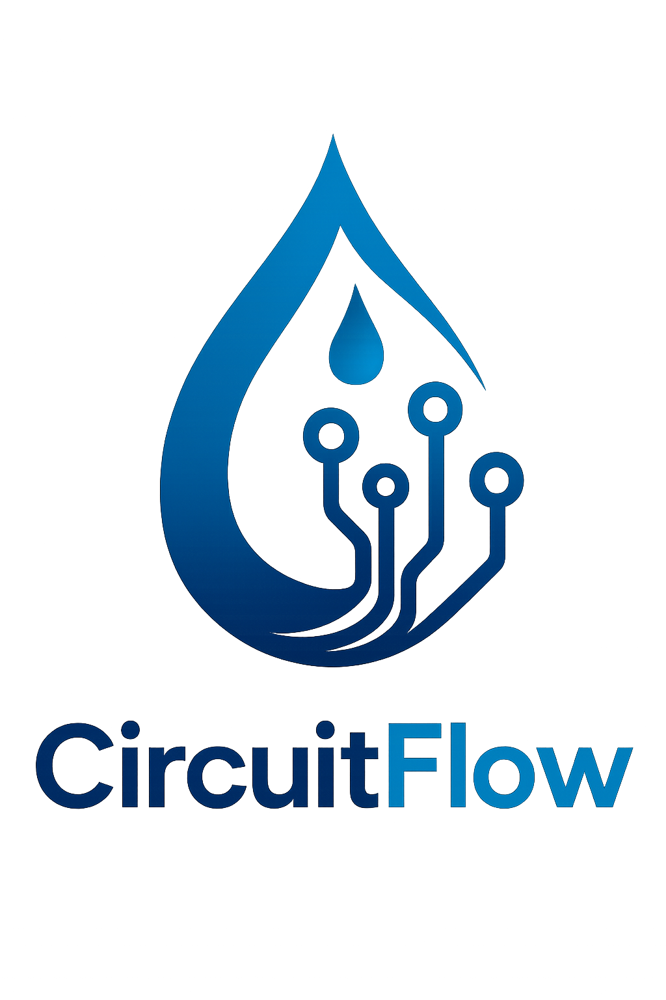

# Server-side events: 
It is a web-technology that enables a one-way, continuous communication from a server to a client. This allows the server to continuously push updates to the client, without needing additional requests from the client.

## How it works: 
SSE operates over standard HTTP connection.
1. The client makes a rehular HTTP request.
2. The server responds, but keeps the connection open indefinitely. 
3. The server sends data as a series of messages. 
