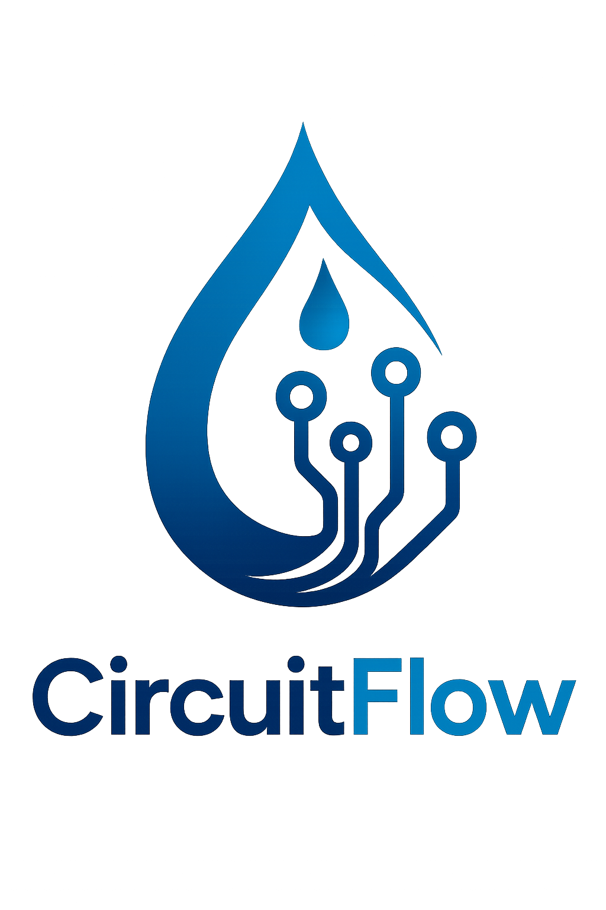

<p align="center">
</p>

# SocketIO:
Socket.io is a <b>javascript</b> library. In the context of python, Socket.IO is implemented using the Flask-SocketIO library.

# Python SocketIO implementation:
```bash
pip install Flask-SocketIO
```
## Components:
1. SocketIO object: It is the central object that wrpas around Flask and controls connection, disconnections, etc.
2. Sending data: 
```bash
emit('event_name', data)
``` 
It sends the event and data <b> back to the client</b> that triggered it.

If the data needs to be sent from another function, use: 
```bash
socketio.emit('event_name', data)
```

3. A complete example: 
```bash
from flask import Flask, render_template
from flask_socketio import SocketIO, emit, request

app = Flask(__name__)
app.config['SECRET_KEY'] = 'your_secret_key' 
socketio = SocketIO(app)

current_count = 0

@app.route('/')
def index():
    # Renders the HTML template containing the client-side JS
    return render_template('index.html')

# --- Socket.IO Event Handlers ---

@socketio.on('connect')
def handle_connect():
    global current_count
    # On new connection, send the current counter value to the client
    print(f"Client connected: {request.sid}")
    emit('update_counter', {'data': current_count})

@socketio.on('increment_request')
def handle_increment():
    global current_count
    current_count += 1
     # Broadcast the new count to ALL connected clients
    socketio.emit('update_counter', {'data': current_count})
    print(f"Counter incremented to: {current_count}")

if __name__ == '__main__':
    socketio.run(app, debug=True)
```
# Differences with flask: 
1. Routing is handled using event handlers, instead of URLs, which are used in Flask.
2. Flask data flow is unidirectional, but socketio ensures bidirectional flow of data.

Date: 06/12/2025