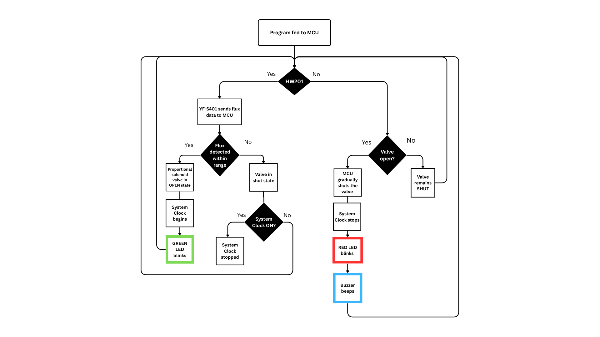

# CircuitFlow

💧 Water Flow Monitoring and Prediction System
 
A real-time water usage monitoring and prediction system built using Arduino, Flask, and a custom neural network. The application collects live sensor data, tracks daily consumption, predicts future water usage, and presents insights through an interactive web dashboard.

## 📌 Features
* Real-time Arduino sensor integration
* Live water flow monitoring
* Automatic daily water consumption calculation
* Neural network–based water usage prediction
* Scheduled daily analysis and prediction
* Web-based dashboard using Flask
* Statistical analysis (average, median, mode)
* Server-Sent Events (SSE) for live updates

## 🏗️ System Overview
The system continuously reads water flow data from an Arduino sensor via serial communication. This data is processed to calculate real-time flow values and cumulative daily usage. At the end of each day, the total water consumption is stored and later used to train a neural network that predicts future usage patterns.

All data and analysis results are visualized using a Flask-based web application.

## Project Architecture

Arduino Sensor
 
     ↓
      
Serial Communication
 
     ↓
      
Data Processing & Storage (CSV)
 
     ↓
      
Neural Network Prediction
 
     ↓
      
Flask Web Application
 
     ↓
      
Live Dashboard & Reports

## Machine Learning Module
* Uses the last four days of water usage as input
* Predicts next day water consumption
 
Includes:

* Data normalization
* Forward propagation
* Backpropagation
* Mean Squared Error loss
 
Predictions are generated automatically once per day and stored for future reference.

## ⏱️ Scheduled Operations
| Task                        | Time     |
| --------------------------- | -------- |
| Daily start time            | 8:00 AM  |
| Daily water usage logging   | 10:00 AM |
| Daily prediction generation | 10:00 AM |

The scheduled tasks are exectued automatically.

## 🛠️ Technologies Used
* Python
* Flask
* NumPy
* Arduino
* Serial Communication
* Chart.js (frontend visualization)
* Server-Sent Events (SSE)

## 🤝 Contributors
* **Gautam Garani** | Data Analyst and Networking| Data Analytics, P2P networking, Android
| https://github.com/GautamGarani
* **Disha G N** | Data Analyst and Design | https://github.com/BlackCatDisha
* **Ashi Chauhan** | Embedded Systems | https://github.com/AshiChauhan1006
* **Suhas V J** | Hardware and Embedded Systems | https://github.com/suhas1307-beep

